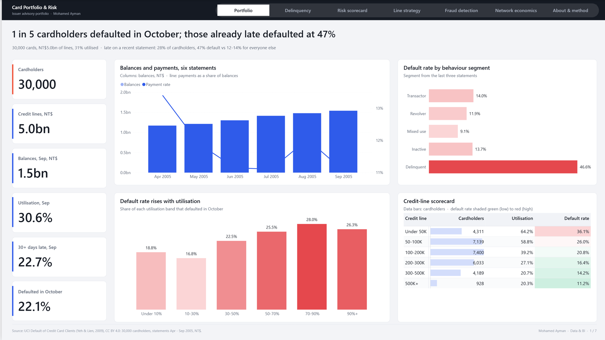
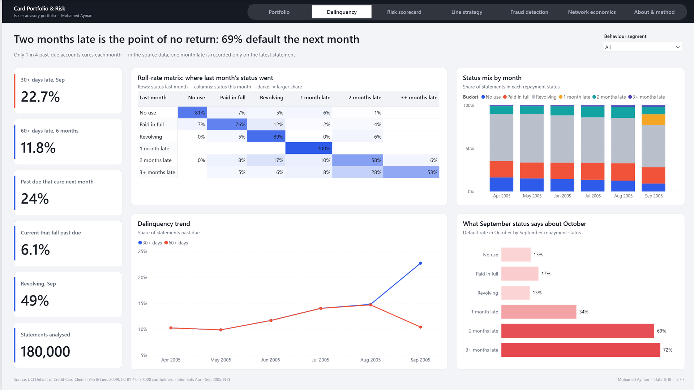
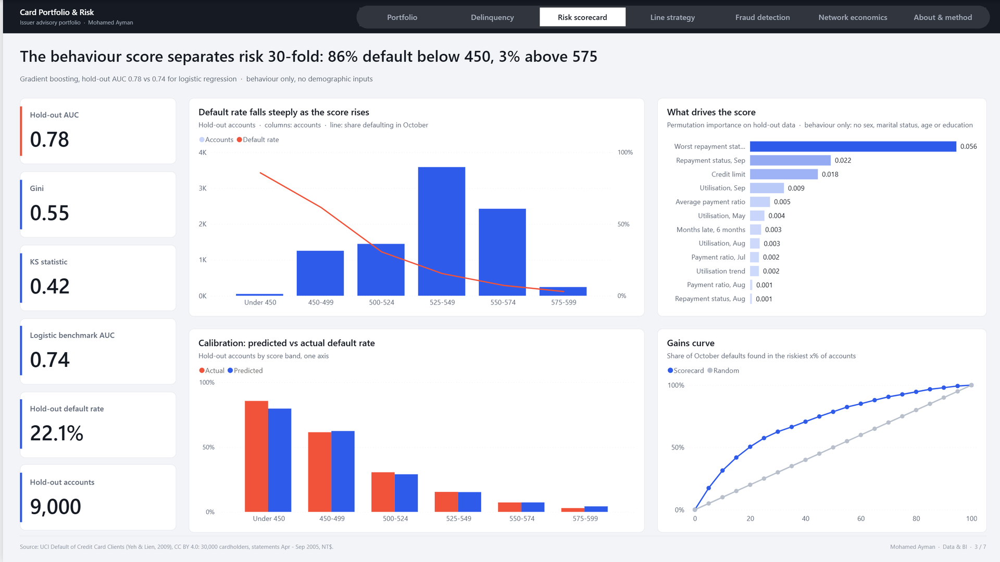
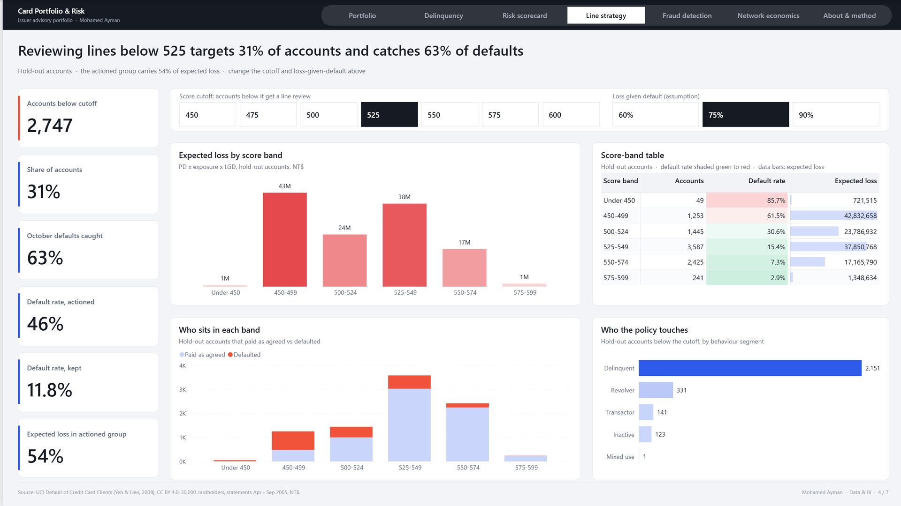
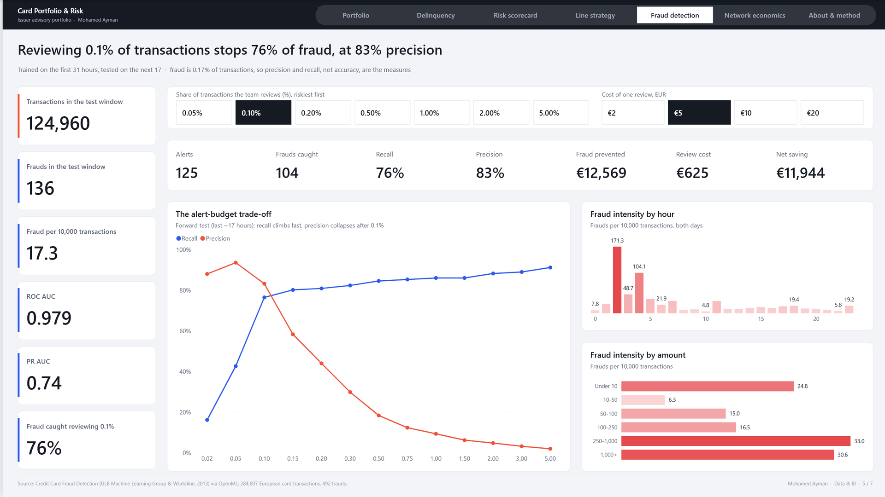
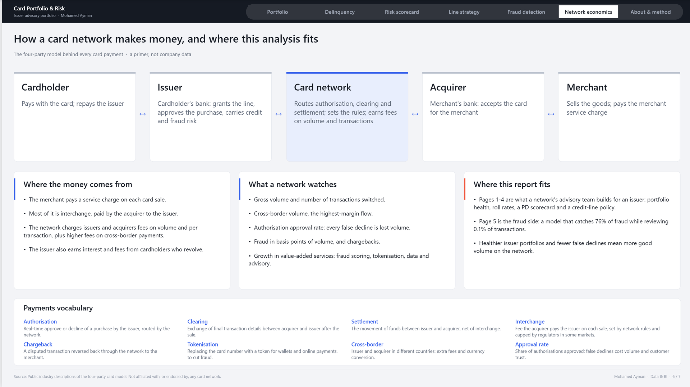
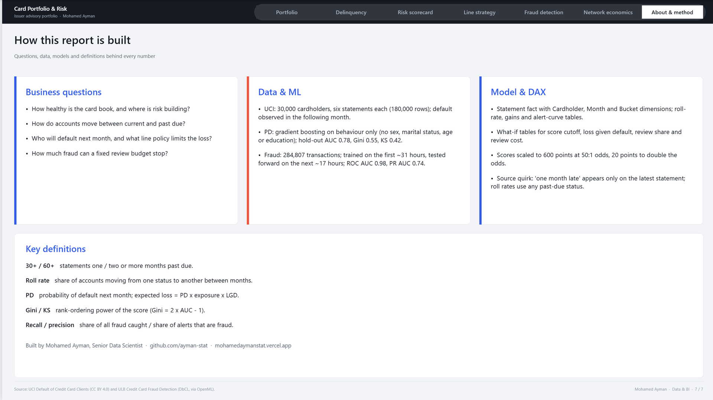

# Card Portfolio & Risk

The analysis a card network's advisory team delivers to an issuing bank: portfolio health, roll rates, a behavioural PD scorecard, a credit-line policy simulator and a fraud alert-budget simulator.

**Domain:** Payments / cards / credit risk  ·  **Built with:** Power BI Desktop (PBIP, PBIR, TMDL), DAX, Python  ·  **Author:** [Mohamed Ayman](https://mohamedaymanstat.vercel.app)



## What the data says

- 1 in 5 cardholders defaulted the following month; those already late on a recent statement defaulted at 47%.
- Two months late is the point of no return: 69% default the next month; only 1 in 4 past-due accounts cures each month.
- Behaviour score: hold-out AUC 0.78 (Gini 0.55, KS 0.42) vs 0.74 for logistic regression, with no demographic inputs.
- Reviewing lines below a score of 525 targets 31% of accounts and catches 63% of defaults (54% of expected loss).
- Fraud: reviewing the riskiest 0.1% of transactions stops 76% of fraud at 83% precision, tested forward in time.

## Pages

| Page | Preview |
|---|---|
| 1. Portfolio |  |
| 2. Delinquency |  |
| 3. Risk scorecard |  |
| 4. Line strategy |  |
| 5. Fraud detection |  |
| 6. Network economics |  |
| 7. About & method |  |

## Model and DAX

- Roll-rate matrix, status mix and delinquency trend from 180,000 statements.
- What-if tables for score cutoff, loss given default, review share and review cost.
- A primer page on the four-party card model, interchange and what a network monitors.

## Machine learning

- PD: gradient boosting on six months of repayment status, utilisation and payment ratios; scores scaled to 600 points at 50:1 odds, 20 points to double.
- Fraud: gradient boosting trained on the first ~31 hours, tested on the next ~17 hours; ROC AUC 0.98, PR AUC 0.74 (fraud is 0.17% of transactions).

## Data science

Three notebooks rebuild both models from the raw data, reproduce the published numbers exactly, then challenge them. Full results, figures and the model card: [ds/README.md](ds/README.md).

- [01 · EDA](ds/notebooks/01_eda_credit_and_fraud.ipynb): undocumented status codes decoded, roll rates, information value, a proxy check on protected attributes, and a step change at midnight in the fraud data.
- [02 · PD scorecard](ds/notebooks/02_pd_scorecard.ipynb): a 6-characteristic WoE points scorecard (AUC 0.746) and a monotone LightGBM challenger (0.778, level with the 0.776 champion); the 525 cutoff, fairness by sex and age band, SHAP reason codes.
- [03 · Fraud model](ds/notebooks/03_fraud_model.ipynb): an unweighted LightGBM challenger (PR AUC 0.790 vs 0.742), a review share chosen on money (0.15%), calibration on rare events and a drift test.

## Design

- Identity: **Card risk**: graphite header with a segmented page control, cobalt and coral, KPIs in a left column so charts get the full height.
- Every page states its finding as the title, names its source in the footer and uses readable field names.
- Value-driven colour (gradients) on bars, conditional formatting in tables, numbers right-aligned under right-aligned headers.
- Each report in this portfolio has its own visual identity; see the other repos linked below.

## Data

- [UCI Default of Credit Card Clients](https://archive.ics.uci.edu/dataset/350/default+of+credit+card+clients): 30,000 Taiwanese cardholders, statements Apr - Sep 2005 (Yeh & Lien, 2009). Licence: CC BY 4.0.
- [Credit Card Fraud Detection (ULB Machine Learning Group & Worldline)](https://www.openml.org/d/1597): 284,807 European card transactions over two days in Sep 2013, 492 frauds; features are PCA components. Licence: DbCL v1.0.

The derived CSVs in `data/` are built by `etl/build_data.py` and keep the source licence above.

## How to run

1. Open `CardPortfolioRisk.pbip` in Power BI Desktop (October 2026 or later; PBIR and DAX user-defined functions).
2. Refresh. The model reads `data/*.csv` straight from this GitHub repo (parameter `DataSource` = GitHub), so no setup or gateway is needed.
3. To rebuild everything from source:

```bash
pip install pandas numpy scikit-learn scipy openpyxl xlrd pyarrow
python etl/build_data.py      # source data -> data/*.csv (and models, where relevant)
python build/model.py         # writes the TMDL semantic model
python build/report.py        # writes the PBIR report
```

The report and model are generated from code (`build/`, using a shared design toolkit), so every visual, measure and page is reviewable in a diff.

## Limitations

- Not affiliated with, or endorsed by, any card network; the network-economics page is a primer built from public descriptions.
- In the UCI file, 'one month late' appears only on the latest statement; roll rates use any past-due status.

## More in this portfolio

- [Olist Marketplace Performance](https://github.com/ayman-stat/powerbi-olist-marketplace): E-commerce / marketplace
- [Retail Bank Campaign Strategy](https://github.com/ayman-stat/powerbi-bank-campaign-strategy): Banking / direct marketing
- [CVM Command Centre: retention, churn and offer experiments](https://github.com/ayman-stat/powerbi-cvm-experiments): CVM / retention / experimentation
- [Retail Network Performance](https://github.com/ayman-stat/powerbi-retail-network): Retail / store operations
- [Telecom Churn & Subscriber Value](https://github.com/ayman-stat/powerbi-telecom-churn-value): Telecom / CVM

---
Mohamed Ayman, Senior Data Scientist  ·  [Portfolio](https://mohamedaymanstat.vercel.app)  ·  [GitHub](https://github.com/ayman-stat)  ·  [LinkedIn](https://www.linkedin.com/in/mohamed-ghareb/)
