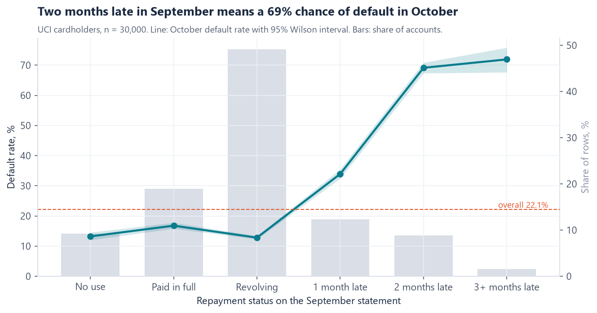
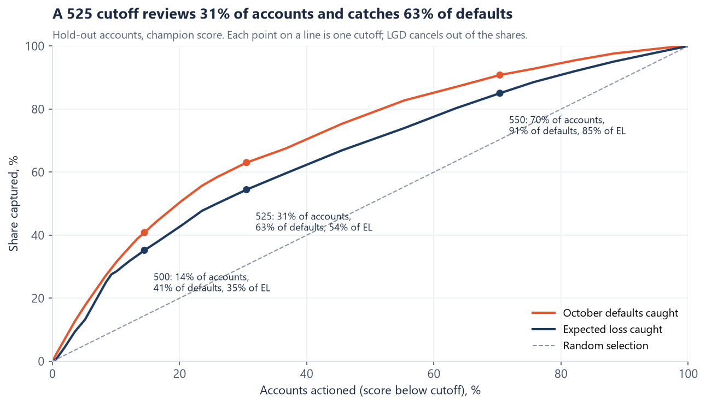
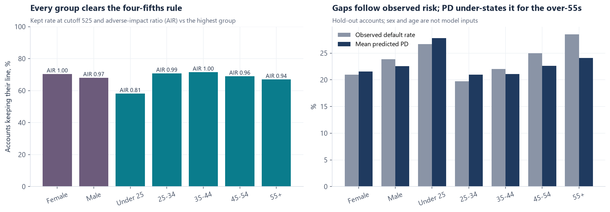
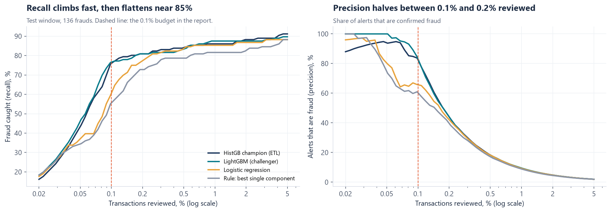

# Data science: card portfolio risk

The Power BI report in this repo is built on two models produced by `etl/build_data.py`: a behavioural probability-of-default
(PD) score for 30,000 cardholders and a fraud score for 284,807 card transactions. These notebooks rebuild both from
the raw data, reproduce every published number first, and then test them properly: a credit-style WoE points scorecard
and a monotone challenger for PD, a value-based review threshold for fraud, calibration, fairness at the cutoff,
explainability and drift.

## Lifecycle

| Stage | Notebook | Key output |
|---|---|---|
| Business and data understanding | [01 · EDA: credit and fraud](notebooks/01_eda_credit_and_fraud.ipynb) | Undocumented status codes decoded; 69% default after two months late; 24% monthly cure rate; IV ranking; protected-attribute proxy check; V3 flips sign at midnight in the fraud data |
| Data preparation | [`features.py`](features.py) + [tests](../tests/test_features.py) | ETL features, split and parameters mirrored line by line; monotonic WoE binner, sign-constrained logistic, points table; 10 unit tests on synthetic data |
| Modelling and evaluation: PD | [02 · PD scorecard](notebooks/02_pd_scorecard.ipynb) | Champion reproduced exactly (AUC 0.776); WoE scorecard 0.746; monotone LightGBM 0.778 (equivalent); 525 cutoff = 31% of accounts, 63% of defaults, 54% of expected loss; fairness and reason codes |
| Modelling and evaluation: fraud | [03 · Fraud model](notebooks/03_fraud_model.ipynb) | Champion reproduced exactly (PR AUC 0.742); unweighted LightGBM 0.790; review share chosen on money (0.15%); calibration; drift test |
| Deployment and monitoring | [Model card](model_card.md) | Intended use, limits, fairness, monitoring triggers, retraining cadence |

## Results

**PD (hold-out: 9,000 accounts, 22.1% default)**

| Model | AUC (95% CI) | Gini | KS | Defaults caught reviewing 30.5% of accounts |
|---|---|---|---|---|
| Rule: September status only | 0.700 (0.687-0.715) | 0.401 | 0.360 | 56.2% |
| WoE scorecard, 6 characteristics | 0.746 (0.732-0.758) | 0.492 | 0.398 | 60.7% |
| Logistic regression (ETL baseline) | 0.740 (0.726-0.753) | 0.480 | 0.391 | 60.5% |
| **HistGradientBoosting champion (published)** | **0.776 (0.764-0.788)** | **0.552** | **0.421** | **63.0%** |
| LightGBM, monotone constraints (challenger) | 0.778 (0.765-0.789) | 0.556 | 0.424 | 63.1% |

Challenger minus champion: +0.002 AUC (paired bootstrap 95% CI 0.000 to +0.004), worth 0.05 points of defaults at the
cutoff volume. Champion minus scorecard: +0.030 (CI 0.023 to 0.037). The champion stays; the monotone model, equally
accurate and guaranteed monotone, is the candidate for the next release.

**Fraud (forward-in-time test: 124,960 transactions, 136 frauds, the 16.6 hours after training)**

| Model | PR AUC (95% CI) | ROC AUC | Recall, top 0.1% | Precision, top 0.1% |
|---|---|---|---|---|
| Rule: largest amounts first | 0.004 (0.002-0.006) | 0.562 | 0.7% | 0.8% |
| Rule: best single component (V14, chosen on training data) | 0.582 (0.505-0.681) | 0.936 | 55.9% | 61.3% |
| Logistic regression | 0.638 (0.550-0.723) | 0.972 | 60.3% | 66.1% |
| **HistGradientBoosting champion, fraud weighted 20x (published)** | **0.742 (0.652-0.825)** | **0.979** | **76.5%** | **83.9%** |
| HistGradientBoosting, no class weight | 0.763 (0.691-0.828) | 0.979 | 73.5% | 80.6% |
| LightGBM, unweighted, tuned (challenger) | 0.790 (0.716-0.854) | 0.985 | 76.5% | 83.9% |
| LightGBM, weight 20 | 0.776 (0.705-0.839) | 0.982 | 72.8% | 79.8% |
| LightGBM, balanced weight (448) | 0.778 (0.701-0.844) | 0.957 | 73.5% | 80.6% |

Challenger minus champion: PR AUC +0.048 (paired bootstrap 95% CI +0.009 to +0.090), recall at 0.1% +0.000 (CI -0.022
to +0.059). The challenger is calibrated without correction (146 frauds expected, 136 observed; the weighted champion
expects 436). Choosing the review share on money (EUR 5 per alert; loss avoided = amount + EUR 20 per fraud) puts the
optimum at 0.15% of transactions, EUR 14,644 net over the 16.6 hours vs EUR 14,028 at the report's 0.1%; the optimum
stays at 0.12-0.30% across every cost assumption tested.

## Key figures

| | |
|---|---|
|  |  |
|  |  |

More: [roll rates](figures/01-roll-rates.png), [information value](figures/01-information-value.png),
[fraud drift](figures/01-fraud-drift.png), [model panel](figures/02-model-panel.png),
[score distribution](figures/02-score-distribution.png), [scorecard points](figures/02-scorecard-points.png),
[PD SHAP](figures/02-shap-beeswarm.png), [fraud cost curve](figures/03-cost-threshold.png),
[fraud calibration](figures/03-calibration.png), [fraud SHAP](figures/03-shap-beeswarm.png), [drift monitor](figures/03-drift-monitor.png).

## Reproduce

The raw files are not in the repo (licences allow redistribution, but they are large). Put them where `etl/build_data.py`
expects them: `.raw/uci/default of credit card clients.xls` (UCI) and `.raw/fraud/creditcard.pq` (OpenML 1597). Then,
from the repo root:

```bash
pip install pandas numpy scikit-learn scipy matplotlib lightgbm optuna shap xlrd pyarrow jupytext nbconvert ipykernel
python -m jupytext --set-kernel python3 --to ipynb --execute ds/notebooks/01_eda_credit_and_fraud.py
python -m jupytext --set-kernel python3 --to ipynb --execute ds/notebooks/02_pd_scorecard.py
python -m jupytext --set-kernel python3 --to ipynb --execute ds/notebooks/03_fraud_model.py
ruff check ds tests && pytest -q          # unit tests need no raw data
```

Each notebook writes its headline numbers to [`reports/metrics.json`](reports/metrics.json) and its charts to
[`figures/`](figures/). Runtimes on a 4-thread budget, measured while other jobs shared the CPU: about 1, 4 and 8 minutes.

`dskit/` is the shared helper library used across this portfolio (audit, EDA, evaluation with bootstrap intervals,
explainability, model selection); it is vendored here unchanged and tested by `tests/test_dskit.py`.
